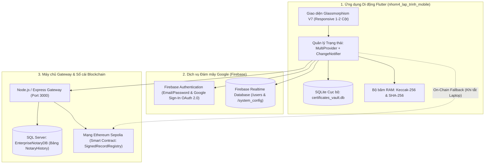

# TÀI LIỆU GIẢI THÍCH CHI TIẾT KIẾN TRÚC & LOGIC CODE DỰ ÁN
## ĐỀ TÀI: HỆ THỐNG XÁC THỰC VĂN BẰNG & CHỨNG CHỈ SỐ BLOCKCHAIN (NHÓM 4)

---

## 1. TỔNG QUAN KIẾN TRÚC HỆ THỐNG (FULL-STACK ARCHITECTURE)

Dự án là một hệ sinh thái hoàn chỉnh gồm **3 khối kiến trúc chính**:



### Các công nghệ & Chuẩn mật mã sử dụng:
1. **Frontend Mobile:** Flutter SDK (Dart 3.x), Material 3, Glassmorphism, Responsive `OrientationBuilder`.
2. **Quản lý Định danh & Phân quyền (RBAC):** Firebase Authentication, Google Play Services OAuth 2.0 (SHA-1/SHA-256 fingerprint), Firebase Realtime Database.
3. **Backend API Gateway:** Node.js (ES Modules), Express.js, `multer` (RAM buffer, không lưu file nháp lên ổ cứng), `express-rate-limit`.
4. **Cơ sở dữ liệu Quan hệ:** Microsoft SQL Server (`EnterpriseNotaryDB`, bảng `NotaryHistory`).
5. **Cơ sở dữ liệu Cục bộ Offline:** SQLite (`sqflite`).
6. **Sổ cái Blockchain:** Ethereum Testnet Sepolia, Smart Contract viết bằng Solidity, kết nối qua `ethers.js v6`.
7. **Chuẩn Mật mã học:** `Keccak-256` (chuẩn Ethereum) và `SHA-256` (chuẩn quốc tế NIST).

---

## 2. PHẦN BACKEND & SMART CONTRACT (`BlockChain_chu_ky_so`)

Thư mục: `d:\Lap_trinh_thiet_bi_di_dong\BlockChain_chu_ky_so\`

### 2.1. File `backend/server.js` (Cổng giao tiếp API Gateway)
- **Tác dụng:** Là cầu nối trung gian giữa ứng dụng di động Flutter, cơ sở dữ liệu SQL Server, và hợp đồng thông minh trên Ethereum Sepolia.
- **Cách hoạt động & Logic code:**
  1. **Khởi tạo & Bảo mật:**
     - Nạp biến môi trường từ file `.env` (`RPC_URL`, `MASTER_PRIVATE_KEY`, `CONTRACT_ADDRESS`, `DB_*`).
     - Áp dụng bộ lọc `cors()` và `express.json()`.
     - `apiLimiter`: Giới hạn tối đa 30 yêu cầu / phút để chống tấn công từ chối dịch vụ (DDoS).
     - `notarizeLimiter`: Giới hạn tối đa 6 lần ký số / phút để **chống spam rút cạn tiền ví Faucet ETH** của nhà trường.
  2. **Xử lý Tải File lên RAM (`multer.memoryStorage`):**
     - Đọc trực tiếp mảng byte nhị phân của file vào bộ nhớ RAM (`req.file.buffer`), không lưu file rác xuống ổ cứng máy tính, bảo vệ quyền riêng tư của tài liệu.
  3. **Tính toán Băm Mật mã kép (Dual-Hash):**
     - Tính `ethers.keccak256(fileBuffer)` để khớp 100% với hàm băm gốc của máy ảo Ethereum (EVM).
     - Tính `crypto.createHash('sha256').update(fileBuffer).digest('hex')` làm chữ ký đối soát phụ.
  4. **Các API Endpoints cốt lõi:**
     - `POST /api/notarize` (Dành riêng cho Cán bộ): Nhận file + thông tin sinh viên $\rightarrow$ Kiểm tra trùng lặp trên SQL Server & Blockchain $\rightarrow$ Tạo giao dịch ghi vào hợp đồng `SignedRecordRegistry.record(dataHash)` $\rightarrow$ Chờ thợ đào xác nhận $\rightarrow$ Lưu thông tin chi tiết vào bảng `NotaryHistory` của SQL Server.
     - `POST /api/verify` (Xác thực văn bằng): Nhận file từ người dùng $\rightarrow$ Băm lấy `keccak256` $\rightarrow$ Tra cứu trên Smart Contract Sepolia `contract.getRecord(dataHash)` $\rightarrow$ Đồng thời tra cứu SQL Server để lấy đầy đủ họ tên, trường cấp $\rightarrow$ Trả về kết quả xác thực hợp lệ hay giả mạo.
     - `GET /api/certificates`: Trả về danh sách toàn bộ văn bằng đã cấp được lưu trong SQL Server.
     - `GET /health`: Kiểm tra tình trạng sống của máy chủ.

### 2.2. File `backend/db.js` (Quản trị Cơ sở Dữ liệu SQL Server)
- **Tác dụng:** Quản lý kết nối Connection Pool đến Microsoft SQL Server cục bộ (`MSI\MSSQLSERVER01`, Database: `EnterpriseNotaryDB`).
- **Cách hoạt động & Logic code:**
  - `ensureTableSchema()`: Tự động chạy khi máy chủ khởi động. Tự tạo bảng `NotaryHistory` nếu bảng chưa tồn tại (chứa các cột: `DataHash`, `SignerAddress`, `TxHash`, `FileName`, `StudentName`, `StudentCode`, `DegreeName`, `IssuerName`, `CreatedAt`).
  - `insertNotaryHistory()`: Lưu một bản ghi sau khi đã ký số thành công lên Blockchain.
  - `getNotaryByHash()`: Tìm kiếm thông tin chi tiết của một văn bằng theo mã băm (`DataHash`).
  - `getAllNotaryRecords()`: Truy vấn danh sách văn bằng theo thứ tự mới nhất xếp trước.

### 2.3. File `contracts/SignedRecordRegistry.sol` (Hợp đồng Thông minh Blockchain)
- **Tác dụng:** Lưu trữ vĩnh viễn và bất biến bằng chứng xác thực văn bằng trên mạng phân tán Ethereum Sepolia.
- **Cách hoạt động & Logic code:**
  - Cấu trúc dữ liệu:
    ```solidity
    struct Record {
        address signer;     // Địa chỉ ví của người ký (Cán bộ trường)
        uint256 timestamp;  // Thời khắc khối (Block Timestamp) được đóng dấu
        bool exists;        // Đánh dấu bản ghi đã tồn tại
    }
    mapping(bytes32 => Record) private _records;
    ```
  - `record(bytes32 dataHash)`: Hàm ghi mã băm của tài liệu lên Blockchain. Nếu mã băm đã tồn tại sẽ báo lỗi `RecordAlreadyExists`. Phát ra sự kiện `RecordAdded`.
  - `getRecord(bytes32 dataHash)`: Hàm đọc (`view`) không tốn phí Gas. Trả về địa chỉ người ký, thời gian đóng dấu và trạng thái tồn tại.
  - `verify(bytes32 dataHash)`: Trả về `true` nếu văn bằng có thật trên sổ gốc, `false` nếu văn bằng giả mạo hoặc chưa từng được cấp.

---

## 3. PHẦN ỨNG DỤNG DI ĐỘNG FLUTTER (`nhom4_lap_trinh_mobile`)

Thư mục: `d:\Lap_trinh_thiet_bi_di_dong\nhom4_lap_trinh_mobile\`

### 3.1. Thư mục Gốc `lib/`

#### 3.1.1. `lib/main.dart` (Điểm Khởi Chạy Ứng Dụng)
- **Tác dụng:** Khởi động hệ thống, liên kết các thư viện nền tảng, thiết lập State Management và điều hướng luồng xác thực ban đầu.
- **Logic code:**
  - `WidgetsFlutterBinding.ensureInitialized()`: Đảm bảo kênh giao tiếp Native (Platform Channels) sẵn sàng.
  - `Firebase.initializeApp()`: Khởi động Firebase Core với cấu hình từ `firebase_options.dart`.
  - `SystemChrome.setPreferredOrientations(...)`: Mở khóa đầy đủ 4 hướng xoay màn hình (dọc, xoay ngược, ngang trái, ngang phải) để kích hoạt giao diện thích ứng (Responsive).
  - `ApiService.loadSavedConfig()`: Đọc lại IP backend và cấu hình chế độ Mock đã lưu từ phiên trước trong `SharedPreferences`.
  - `MultiProvider`: Cung cấp 3 Provider chủ chốt (`ApiService`, `ThemeProvider`, `AuthProvider`) cho toàn bộ cây widget.
  - `AuthGate`: Sử dụng `StreamBuilder<User?>` lắng nghe luồng `authStateChanges`. Nếu người dùng đã đăng nhập thì tự động mở `HomeScreen`, nếu chưa thì mở `AuthScreen`.

#### 3.1.2. `lib/firebase_options.dart` (Cấu hình Firebase Đa Nền Tảng)
- **Tác dụng:** Lưu thông số kết nối chính thức đến dự án Firebase `nhom4-blockchain-verifier`.
- **Logic code:** Tự động trả về đối tượng `FirebaseOptions` tương ứng với nền tảng đang chạy (`android`, `ios`, `web`). Chứa `apiKey`, `appId`, `messagingSenderId`, `projectId`, `databaseURL` (`https://nhom4-blockchain-verifier-default-rtdb.firebaseio.com`), và `storageBucket`.

---

### 3.2. Thư mục Dữ liệu Mô hình (`lib/models/`)

#### 3.2.1. `lib/models/certificate_record.dart`
- **Tác dụng:** Đại diện cho một bản ghi chứng nhận văn bằng trên hệ thống.
- **Logic code:** Chứa các trường dữ liệu: `id`, `dataHash`, `signer`, `timestamp`, `fileName`, `fileType`, `txHash`, `studentName`, `studentCode`, `degreeName`, `issuerName`. Cung cấp các phương thức `fromJson()`, `toJson()`, `fromMap()`, `toMap()` để chuyển đổi linh hoạt giữa API REST, Firebase và bảng SQLite.

#### 3.2.2. `lib/models/scan_history_model.dart`
- **Tác dụng:** Mô hình lưu lịch sử các lần người dùng quét mã QR hoặc tải file kiểm tra.
- **Logic code:** Lưu `id`, `dataHash`, `fileName`, `scanMethod` ('QR' hoặc 'FILE'), `isValid` (1 là hợp lệ, 0 là giả mạo), `scannedAt`. Dùng để ghi và đọc từ bảng `scan_history` trong cơ sở dữ liệu SQLite cục bộ.

#### 3.2.3. `lib/models/user_model.dart`
- **Tác dụng:** Quản lý thông tin định danh và phân quyền người dùng (Role-Based Access Control).
- **Logic code:**
  - Định nghĩa 3 hằng số vai trò trong `UserRole`: `student` (Sinh viên), `employer` (Nhà tuyển dụng), `staff` (Cán bộ đào tạo).
  - **Cơ chế băm bảo mật SHA-256:**
    - `defaultStaffPasscodeSha256`: Lưu chuỗi băm một chiều của mã ủy quyền Cán bộ mặc định (`327cc519e547...`). Tuyệt đối không lưu chữ thuần trong file code để chống lộ lọt khi push lên GitHub.
    - `hashPasscode(raw)`: Băm một chuỗi bất kỳ sang mã hex SHA-256 64 ký tự.
    - `verifyPasscode(input, {remoteConfigValue})`: Đối chiếu mã người dùng nhập với cấu hình động trên Firebase Realtime Database hoặc mã mặc định.
  - Class `UserModel`: Lưu `uid`, `name`, `email`, `avatarBase64OrUrl`, `role`, `organization`, `studentCode`, `createdAt`.

---

### 3.3. Thư mục Quản lý Trạng thái (`lib/providers/`)

#### 3.3.1. `lib/providers/auth_provider.dart`
- **Tác dụng:** Là "bộ não" điều phối toàn bộ vòng đời xác thực của người dùng trên toàn ứng dụng.
- **Logic code:**
  - Kế thừa `ChangeNotifier`, thông báo cho giao diện vẽ lại mỗi khi dữ liệu người dùng thay đổi.
  - `_initAuth()`: Tự động khôi phục phiên làm việc khi mở app (từ `FirebaseAuth.currentUser` hoặc `SharedPreferences.last_logged_in_uid`).
  - `login()`: Đăng nhập bằng Email & Mật khẩu.
  - `register()`: Đăng ký tài khoản mới kèm kiểm tra mã ủy quyền Cán bộ nếu chọn vai trò `staff`.
  - `loginWithGoogle()`: Đăng nhập một chạm bằng Google thật, tự tạo hồ sơ nếu là lần đầu đăng nhập.
  - `resetPassword(email)`: Gửi email khôi phục mật khẩu từ Google về hộp thư thật.
  - `deleteAccount()`: Xóa tài khoản vĩnh viễn 3 tầng (xóa Auth, xóa Realtime Database, xóa local cache).
  - `upgradeToStaff(passcode)`: Xác thực mã ủy quyền động để nâng cấp quyền Cán bộ.
  - `switchRoleForDemo(newRole)`: Hỗ trợ chuyển đổi nhanh 3 vai trò phục vụ biểu diễn chấm thi.

#### 3.3.2. `lib/providers/theme_provider.dart`
- **Tác dụng:** Quản lý chế độ hiển thị Giao diện Sáng (Light Mode) và Tối (Dark Mode).
- **Logic code:**
  - Lưu và đọc cấu hình giao diện từ khóa `theme_mode` trong `SharedPreferences`.
  - Định nghĩa sẵn `lightTheme` và `darkTheme` chuẩn Material 3: thiết lập bảng màu chủ đạo (Deep Violet & Teal), phông chữ, định dạng viền bo cong Card (16px), và độ trong suốt phục vụ hiệu ứng kính mờ (Glassmorphism).

---

### 3.4. Thư mục Dịch vụ Cốt lõi (`lib/services/`)

#### 3.4.1. `lib/services/api_service.dart` (Giao tiếp Mạng & Cứu nguy On-Chain)
- **Tác dụng:** Gửi yêu cầu HTTP đến Backend Node.js và chứa cơ chế tự phục hồi On-Chain Fallback khi tắt Laptop.
- **Logic code:**
  - `notarizeFileStream()`: Gửi multipart/form-data chứa file và thông tin sinh viên lên Backend để ký số.
  - `verifyFileStream()`: Gửi file lên API `/api/verify` để kiểm tra tính hợp lệ.
  - **Cơ chế On-Chain Fallback (`verifyDirectlyOnSepolia`):**
    - Nếu máy tính Laptop tắt (Backend không chạy, cổng 3000 đóng), ứng dụng **không bị báo lỗi mất mạng**.
    - Nó tự động gửi cuộc gọi RPC `eth_call` trực tiếp lên máy chủ công cộng Ethereum Sepolia (`https://ethereum-sepolia-rpc.publicnode.com`).
    - Gọi hàm `decodeOnChainGetRecordResult(rawHex)`: Tự tay giải mã chuỗi nhị phân ABI hex (192 ký tự) trả về từ EVM để lấy ra địa chỉ ví người ký (`signer`) và thời gian đóng dấu (`timestamp`). Đảm bảo App luôn tra cứu được bằng cấp 24/7!
  - `setBaseUrl()` / `loadSavedConfig()`: Cho phép đổi linh hoạt địa chỉ IP của Backend trong màn hình Cài đặt và lưu vĩnh viễn trên máy.

#### 3.4.2. `lib/services/auth_service.dart` (Bọc Xác thực Firebase & Google)
- **Tác dụng:** Xử lý các thao tác mật mã định danh với Firebase Auth và Google Sign-In SDK.
- **Logic code:**
  - `signInWithGoogle()`: Luôn gọi `signOut()` trước để bảng chọn tài khoản hiện lên. Nếu người dùng hủy chọn (`googleUser == null`), báo lỗi hủy chọn và giữ nguyên ở màn hình đăng nhập (không bao giờ tự vào tài khoản giả). Bắt lỗi `ApiException: 10` để nhắc nhở cấu hình SHA-1.
  - `signUpWithEmailPassword()` / `signInWithEmailPassword()`: Xử lý đăng ký/đăng nhập chuẩn, hỗ trợ tài khoản demo đặc biệt (`canbo@edu.vn`, `doanhnghiep@company.com`, `sinhvien@edu.vn`) cho giảng viên chấm thi nhanh.
  - `sendPasswordResetEmail(email)`: Gọi API gửi thư đặt lại mật khẩu từ Firebase.
  - `deleteAccount(uid)`: Xóa tài khoản trên Firebase Auth, tự kích hoạt xác thực lại với Google (`reauthenticateWithCredential`) nếu phiên đăng nhập đã lâu, sau đó ngắt kết nối Google Sign-In.
  - `getAuthErrorMessage()`: Dịch toàn bộ mã lỗi tiếng Anh của Firebase (`user-not-found`, `wrong-password`, `invalid-credential`, v.v.) sang tiếng Việt thân thiện.

#### 3.4.3. `lib/services/user_service.dart` (Đồng bộ Hồ sơ & Phân quyền Realtime)
- **Tác dụng:** Quản lý cơ sở dữ liệu thời gian thực trên Firebase Realtime Database kết hợp bộ đệm SharedPreferences.
- **Logic code:**
  - `saveUserProfile(user)`: Luôn lưu vào bộ nhớ máy trước. Nếu là tài khoản thật (không bắt đầu bằng `demo_`), đồng bộ lên nhánh `/users/{uid}` trên Firebase.
  - `getUserProfile(uid)`: Đọc từ Firebase với thời gian chờ 4 giây, nếu không có mạng tự động nạp từ cache offline.
  - `verifyStaffPasscode(passcode)`: Truy cập nhánh `/system_config/staff_passcode_sha256` trên Firebase Realtime Database để kiểm tra mã ủy quyền động do Admin cấu hình từ xa.
  - `cleanupDemoNodesOnFirebase()`: Tự động dọn dẹp các nhánh tài khoản mẫu cũ (`demo_student_003`, `demo_employer_002`) để giữ bảng dữ liệu Firebase luôn sạch sẽ.
  - `deleteUserProfile(uid)`: Xóa dữ liệu cả trên Firebase Realtime Database lẫn bộ nhớ máy.

#### 3.4.4. `lib/services/hash_service.dart` (Động Cơ Băm Mật Mã Trên RAM Máy Khách)
- **Tác dụng:** Băm trực tiếp dữ liệu nhị phân của tài liệu trên điện thoại để kiểm tra tính toàn vẹn.
- **Logic code:**
  - `computeKeccak256(bytes)`: Dùng thuật toán `KeccakDigest(256)` từ gói `pointycastle` để sinh mã băm chuẩn Ethereum (khớp 100% với Smart Contract).
  - `computeSha256(bytes)`: Dùng thuật toán SHA-256 từ gói `crypto` chuẩn quốc tế.
  - `notarizeFileStream()` & `verifyFileStream()`: Sử dụng mô hình `Stream<Progress>` bất đồng bộ. Bắn ra từng bước tiến độ (Đang đọc file $\rightarrow$ Đang băm $\rightarrow$ Đang gửi lên Blockchain $\rightarrow$ Hoàn thành) kèm phần trăm (0% $\rightarrow$ 100%) giúp giao diện hiển thị hiệu ứng mượt mà.
  - **Xác thực tự động kép:** Khi người dùng đưa một file vào kiểm tra, hàm tự động băm và đối soát cả `Keccak-256` lẫn `SHA-256`, đảm bảo văn bằng ký bằng bất kỳ chuẩn nào cũng nhận diện chính xác 100%.

#### 3.4.5. `lib/services/db_service.dart` (Cơ Sở Dữ Liệu SQLite Cục Bộ)
- **Tác dụng:** Cung cấp kho lưu trữ ngoại tuyến trên thiết bị (Sổ tay văn bằng & Lịch sử tra cứu).
- **Logic code:**
  - Thiết kế theo mô hình **Singleton Pattern** (`DatabaseService._init()`).
  - Khởi tạo file CSDL `certificates_vault.db` với 2 bảng:
    - Bảng `certificates`: Lưu các chứng chỉ văn bằng người dùng đã lưu vào sổ tay cá nhân.
    - Bảng `scan_history`: Lưu vết các lần quét mã QR hoặc đối soát file.
  - Cung cấp các hàm CRUD: `insertCertificate()`, `getAllCertificates()`, `deleteCertificate()`, `insertScanHistory()`, `getAllScanHistory()`, `clearScanHistory()`.
  - Có lớp bọc an toàn `_safeDatabase()` giúp app không bị crash khi chạy trong môi trường kiểm thử tự động (Unit Test).

---

### 3.5. Thư mục Màn hình Giao diện (`lib/screens/`)

#### 3.5.1. Nhóm Xác thực (`lib/screens/auth/`)
- **`auth_screen.dart` (Màn hình Đăng nhập):**
  - Form nhập Email và Mật khẩu có kiểm tra định dạng regex.
  - Nút **"Quên mật khẩu?"**: Mở hộp thoại nhập email để nhận link đổi mật khẩu từ Firebase.
  - Nút **"Đăng nhập với Google"**: Tích hợp nút icon Google chính thức.
  - 3 nút đăng nhập nhanh tài khoản mẫu (Cán bộ, Tuyển dụng, Sinh viên) để demo nhanh.
- **`register_screen.dart` (Màn hình Đăng ký):**
  - Đăng ký tài khoản mới với lựa chọn 1 trong 3 vai trò.
  - Nếu chọn vai trò Cán bộ (`staff`), khung cảnh báo bảo mật màu vàng tự động mở ra yêu cầu nhập "Mã ủy quyền Cán bộ nhà trường" để ngăn ngừa kẻ xấu tự tạo tài khoản rút tiền ví ETH.
- **`profile_screen.dart` (Màn hình Hồ sơ Cá nhân):**
  - Hiển thị Họ tên, Email, Mã định danh UID, MSSV, Đơn vị đào tạo.
  - Cho phép đổi ảnh đại diện từ Camera hoặc Thư viện ảnh (mã hóa Base64 đồng bộ lên Firebase).
  - Khung chuyển đổi vai trò nhanh (SegmentedButton) cho phép trải nghiệm cả 3 góc nhìn của hệ thống.
  - Nút **"ĐĂNG XUẤT"** và nút màu đỏ **"XÓA VĨNH VIỄN TÀI KHOẢN"** kèm hộp thoại xác nhận bảo mật.

#### 3.5.2. Nhóm Màn hình Chính & Tra cứu (`lib/screens/verifier/`)
- **`home_screen.dart` (Khung Điều Hướng Chính & Phân Quyền 3 Vai Trò):**
  - Sử dụng thanh điều hướng kính mờ `GlassyBottomNavBar` với hiệu ứng viên thuốc trượt mềm mại (320ms, `Curves.easeOutCubic`).
  - Quản lý các Tab thông minh qua `GlassAnimatedIndexedStack` (giữ nguyên vẹn 100% dữ liệu các Tab khi chuyển qua lại) và mở khóa Tab chuyên biệt theo đúng vai trò người dùng:
    - **Cán bộ đào tạo (`staff` - 4 Tab):** `Xác thực` $\rightarrow$ `Sổ tay & Lịch sử` $\rightarrow$ **`Cấp bằng`** (`IssueCertificateScreen` + nút mở `IssuedListScreen`) $\rightarrow$ `Cài đặt`.
    - **Nhà tuyển dụng (`employer` - 4 Tab):** `Xác thực` $\rightarrow$ `Sổ tay & Lịch sử` $\rightarrow$ **`Thẩm định HR`** (`EmployerAuditTab`) $\rightarrow$ `Cài đặt`.
    - **Sinh viên (`student` - 3 Tab):** `Xác thực` $\rightarrow$ `Sổ tay & Lịch sử` (kèm bộ lọc nhanh MSSV cá nhân) $\rightarrow$ `Cài đặt`.
- **`verify_tab.dart` (Tab Tải File & Xác thực Văn Bằng):**
  - Khu vực kéo thả / chọn file PDF hoặc Ảnh bằng cấp.
  - Tích hợp `ProgressStreamCard` hiển thị sóng tiến trình tính toán băm và truy vấn Blockchain.
  - Nút nổi mở nhanh Camera quét mã QR.
- **`verify_detail_screen.dart` (Màn hình Kết Quả Chi Tiết & Nghiệp Vụ HR):**
  - Hiển thị huy hiệu to bản: **"VĂN BẰNG HỢP LỆ (CHÍNH CHỦ)"** (màu xanh lá) hoặc **"CẢNH BÁO BẰNG GIẢ / KHÔNG TỒN TẠI"** (màu đỏ).
  - Trình bày chi tiết: Tên sinh viên, MSSV, Tên văn bằng, Đơn vị cấp phát, Mã giao dịch Blockchain (`TxHash`), Mã số văn bằng (`DataHash`), Ngày cấp trên Blockchain.
  - Nút lưu văn bằng vào Sổ tay Offline và phóng to mã QR để Sinh viên xuất trình khi phỏng vấn.
  - **Khối Quyết định Thẩm định Tuyển dụng (Dành riêng cho `employer`):**
    - Cho phép HR chấm trạng thái hồ sơ ứng viên (`Đạt thẩm định`, `Chờ bổ sung`, `Từ chối`), ghi chú nhận xét phỏng vấn và lưu vào bộ nhớ (`hr_reviews_map`).
    - Nút **"Xuất Biên bản Thẩm định HR"**: Tạo biên bản đối soát đầy đủ thông tin ứng viên, kết quả Blockchain, tên đơn vị HR và cho phép sao chép 1 chạm vào Clipboard.
  - **Tương thích Responsive:** Khi xoay ngang màn hình (hoặc chạy trên Máy tính bảng / Tablet), tự động phân thành **2 cột song song** nhờ `OrientationBuilder`.
- **`qr_scanner_screen.dart` (Màn hình Quét Mã QR):**
  - Điều khiển camera qua thư viện `mobile_scanner`. Có khung ngắm quét laser chuyển động, nút bật/tắt đèn Flash và nút đổi camera trước/sau.

#### 3.5.3. Nhóm Thẩm định Tuyển dụng HR (`lib/screens/employer/`)
- **`employer_audit_tab.dart` (Tab Trung Tâm Thẩm Định HR - Dành riêng cho Nhà tuyển dụng):**
  - **Bảng thống kê KPI Thẩm định HR:** Tổng hợp trực tiếp từ lịch sử quét (`DatabaseService.instance.getAllScanHistory()`) và danh sách đánh giá HR (`hr_reviews_map`), hiển thị 4 chỉ số: *Tổng lượt thẩm định*, *Văn bằng Hợp lệ*, *Cảnh báo bằng giả*, và *Ứng viên Đạt tuyển*.
  - **Tra cứu Hồ sơ Văn bằng Ứng viên (`_buildCandidateLookupCard`):** Cho phép HR nhập Mã số sinh viên (MSSV) hoặc Họ tên ứng viên để truy vấn toàn bộ bằng cấp đã cấp cho ứng viên đó qua `ApiService.fetchIssuedCertificates(keyword: ...)`.
  - **Danh sách Ứng viên đã đánh giá (`_buildReviewedCandidatesCard`):** Lọc nhanh hồ sơ theo trạng thái (`Tất cả`, `Đạt thẩm định`, `Chờ bổ sung`, `Từ chối`), xem ghi chú phỏng vấn và mở lại màn hình chi tiết văn bằng.
  - **Responsive 1–2 cột:** Sử dụng `OrientationBuilder` hiển thị 1 cột khi cầm dọc và chia 2 cột song song khi xoay ngang màn hình.

#### 3.5.4. Nhóm Sổ tay Ngoại Tuyến (`lib/screens/vault/`)
- **`vault_tab.dart` (Tab Sổ tay Cá nhân & Lịch sử):**
  - Chuyển đổi linh hoạt giữa 2 danh sách: "Sổ tay đã lưu" và "Lịch sử tra cứu".
  - **Tính năng riêng cho Sinh viên (`student`):** Tự động hiển thị nút lọc nhanh 1 chạm **`🎓 Văn bằng của tôi (MSSV: ...)`** khi sinh viên đã khai báo mã số sinh viên trong hồ sơ, giúp lọc ngay các văn bằng chính chủ của mình để xuất trình mã QR.
  - Cho phép tìm kiếm theo tên sinh viên, MSSV hoặc tên bằng cấp ngay cả khi không có Internet.
  - Hỗ trợ xóa lịch sử hoặc xem lại chi tiết chứng chỉ bất kỳ lúc nào.

#### 3.5.5. Nhóm Cấp bằng Ký số (`lib/screens/issuer/`)
- **`issue_certificate_screen.dart` (Màn hình Ký số Văn bằng - Dành riêng Cán bộ):**
  - Cho phép Cán bộ chụp ảnh văn bằng gốc hoặc chọn file PDF từ máy.
  - **Tuyệt chiêu kỹ thuật:** Không đặt `maxWidth` / `maxHeight` khi chụp ảnh để bảo toàn nguyên vẹn 100% mảng byte gốc, đảm bảo mã băm ảnh lúc cấp và lúc kiểm tra luôn khớp nhau từng bit một.
  - Nhập thông tin sinh viên $\rightarrow$ Bấm "Ký số & Đóng dấu Blockchain" $\rightarrow$ `ProgressStreamCard` hiển thị tiến trình ký $\rightarrow$ Tự động sinh mã QR xác thực để in lên bằng tốt nghiệp.
- **`issued_list_screen.dart` (Danh sách Văn bằng Toàn trường):**
  - Lấy dữ liệu từ SQL Server Backend hiển thị danh sách tất cả các văn bằng đã được nhà trường cấp phép và lưu trữ trên Blockchain.

#### 3.5.6. Nhóm Cài đặt Hệ thống (`lib/screens/settings/`)
- **`settings_tab.dart` (Tab Cài đặt & Tinh chỉnh):**
  - Chuyển đổi giao diện Sáng / Tối.
  - Cấu hình địa chỉ IP máy chủ Backend (tiện lợi khi chạy demo trên điện thoại thật kết nối cùng Wi-Fi với laptop).
  - Nút **"Kiểm tra kết nối Sổ gốc Ethereum Sepolia"**: Gửi lệnh `eth_blockNumber` lên RPC Sepolia kiểm tra độ trễ mạng Internet.
  - Công tắc "Chế độ dùng thử (Mock Mode)": Cho phép demo chấm thi giả lập khi không có mạng và tắt laptop.

---

### 3.6. Thư mục Thành phần Giao diện Dùng chung (`lib/widgets/`)

#### 3.6.1. `lib/widgets/glass_widgets.dart` (Bộ Giao Diện Kính Mờ Glassmorphism V7)
- **`GlassScaffoldBackground`:** Nền dải màu chuyển sắc sâu thẳm kết hợp 2 khối cầu năng lượng (Gradient Orbs) làm nổi bật hiệu ứng mờ kính phía trên.
- **`GlassCard`:** Thẻ kính mờ sử dụng `BackdropFilter` với độ nhòe `sigmaX: 16, sigmaY: 16`, viền bo góc bán trong suốt và bóng đổ mềm mại.
- **`GlassyBottomNavBar`:** Thanh điều hướng dưới đáy bằng kính mờ với viên thuốc trượt hoạt họa `AnimatedPositioned` và hiệu ứng nảy nhẹ khi bấm ngón tay.
- **`GlassAnimatedIndexedStack`:** Widget chuyển đổi các Tab mượt mà không làm tải lại giao diện và giữ nguyên vẹn 100% dữ liệu đang nhập dở trên từng Tab.

#### 3.6.2. `lib/widgets/progress_stream_card.dart`
- **Tác dụng:** Hiển thị thẻ tiến trình băm tài liệu và ghi sổ cái Blockchain trực quan theo thời gian thực.
- **Logic code:** Lắng nghe luồng sự kiện từ `HashService`, hiển thị thanh tiến trình phần trăm co giãn mượt mà bằng `TweenAnimationBuilder<double>`, biểu tượng trạng thái xoay tròn và các thông điệp tiếng Việt dễ hiểu từng bước.

#### 3.6.3. `lib/widgets/certificate_card.dart`
- **Tác dụng:** Thẻ hiển thị tóm tắt một văn bằng trong danh sách (Tên bằng cấp, Họ tên sinh viên, Ngày cấp, Mã băm rút gọn và icon trạng thái).

---

## 4. BỘ KIỂM THỬ TỰ ĐỘNG TOÀN DIỆN (`test/widget_test.dart`)

File kiểm thử gồm **16 kịch bản tự động (Pass 16/16)** bao quát toàn bộ yêu cầu đồ án:
1. `Test 1 (TV1)`: Kiểm tra hàm băm `Keccak-256` và `SHA-256` khớp chuẩn toán học với thư viện mật mã.
2. `Test 2 (TV1)`: Kiểm tra `ApiService` lưu và đọc cấu hình BaseUrl qua `SharedPreferences`.
3. `Test 3 (TV2)`: Kiểm tra `UserModel` chuyển đổi JSON và phân quyền chính xác 3 vai trò.
4. `Test 4 (TV2)`: Kiểm tra `AuthProvider` đăng nhập tài khoản demo và đổi vai trò.
5. `Test 5 (TV2)`: Kiểm tra `AuthGate` tự động mở màn hình đăng nhập khi chưa có phiên làm việc.
6. `Test 6 (TV2)`: Kiểm tra màn hình `IssueCertificateScreen` chỉ mở cho Cán bộ và xoay ngang 2 cột.
7. `Test 7 (TV3)`: Kiểm tra mô hình `ScanHistoryModel` và `CertificateRecord` chuyển đổi Map SQLite.
8. `Test 8 (TV3)`: Kiểm tra `HomeScreen` tích hợp đủ các Tab và thanh điều hướng kính mờ.
9. `Test 9 (TV3)`: Kiểm tra `VerifyDetailScreen` hiển thị chứng nhận và không tràn pixel khi xoay ngang.
10. `Test 10 (Stress Test)`: Kiểm tra toàn bộ các màn hình trên thiết bị hẹp (340px) và chữ phóng to 1.18x ở chế độ Dark Mode không bao giờ tràn viền (0 Overflow).
11. `Test 11 (On-Chain Fallback)`: Kiểm tra giải mã chuỗi nhị phân ABI hex trực tiếp từ Ethereum Sepolia khi tắt laptop.
12. `Test 12 (Roundtrip)`: Ký số file Ảnh & PDF rồi kiểm tra lại chính file gốc phải khớp 100%, file bị sửa 1 byte phải báo giả mạo.
13. `Test 13 (Google Security)`: Kiểm tra bảo mật Google Sign-In không bao giờ tự ý đăng nhập tài khoản giả khi người dùng hủy chọn.
14. `Test 14 (Password & Deletion)`: Kiểm tra gửi email khôi phục mật khẩu và xóa tài khoản vĩnh viễn 3 tầng.
15. `Test 15 (Dynamic Passcode)`: Kiểm tra cơ chế băm SHA-256 đối chiếu mã ủy quyền Cán bộ động từ Firebase Realtime Database.
16. `Test 16 (Employer & Student Role Differentiation)`: Kiểm tra vai trò Nhà tuyển dụng (`employer`) mở khóa Tab thứ 3 **Thẩm định HR** (`EmployerAuditTab`), xoay ngang 2 cột mượt mà, chấm trạng thái tuyển dụng ứng viên và xuất **Biên bản Thẩm định HR** trên `VerifyDetailScreen`.
