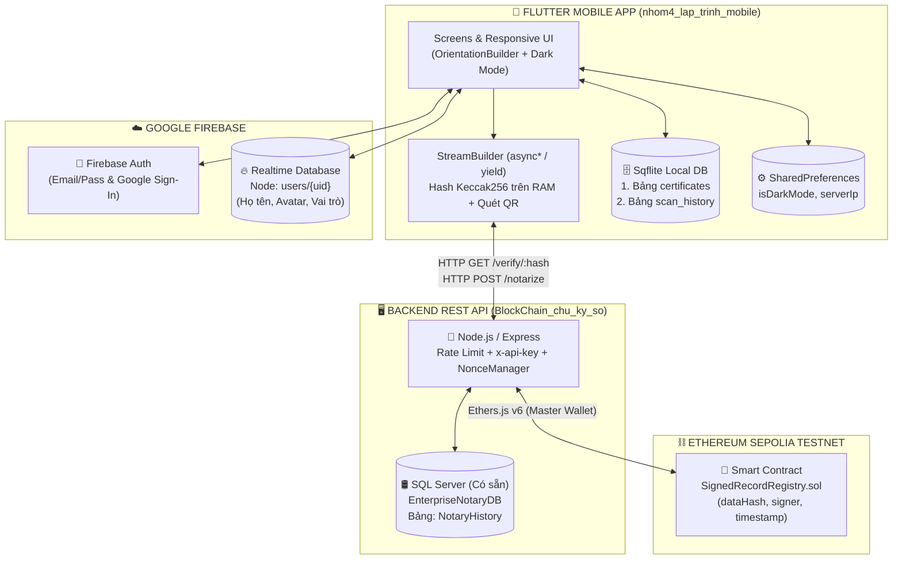

# KẾ HOẠCH XÂY DỰNG HOÀN CHỈNH ỨNG DỤNG DI ĐỘNG FLUTTER
## ĐỀ TÀI: ỨNG DỤNG XÁC THỰC VĂN BẰNG & CHỨNG CHỈ SỐ BLOCKCHAIN (BLOCKCHAIN CERTIFICATE & DEGREE VERIFIER)

---

## MỤC LỤC
1. [Báo cáo Quét 3 Project & Đánh giá Hiện trạng](#1-báo-cáo-quét-3-project--đánh-giá-hiện-trạng)
2. [Kiểm tra Chức năng "Thêm Ảnh / Tài liệu để Ký số" trên `BlockChain_chu_ky_so` & Hướng dẫn Bổ sung](#2-kiểm-tra-chức-năng-thêm-ảnh--tài-liệu-để-ký-số-trên-blockchain_chu_ky_so--hướng-dẫn-bổ-sung)
3. [Quy chuẩn Phong cách Lập trình (Đúc kết từ `flutter_demo`)](#3-quy-chuẩn-phong-cách-lập-trình-đúc-kết-từ-flutter_demo)
4. [Kiến trúc Hệ thống & Thiết kế Cơ sở Dữ liệu (SQL Server + Firebase + Sqflite)](#4-kiến-trúc-hệ-thống--thiết-kế-cơ-sở-dữ-liệu-sql-server--firebase--sqflite)
5. [Cấu trúc Thư mục Chuẩn cho `nhom4_lap_trinh_mobile` & Thư viện cần cài đặt](#5-cấu-trúc-thư-mục-chuẩn-cho-nhom4_lap_trinh_mobile--thư-viện-cần-cài-đặt)
6. [Phân công Công việc Chi tiết cho Nhóm 3 Thành viên](#6-phân-công-công-việc-chi-tiết-cho-nhóm-3-thành-viên)
7. [Quy trình Quản lý Mã nguồn GitHub & Kịch bản Chạy Local (Không Deploy)](#7-quy-trình-quản-lý-mã-nguồn-github--kịch-bản-chạy-local-không-deploy)
8. [Lộ trình Thực hiện 4 Giai đoạn & Checklist Nghiệm thu Đồ án](#8-lộ-trình-thực-hiện-4-giai-đoạn--checklist-nghiệm-thu-đồ-án)

---

## 1. BÁO CÁO QUÉT 3 PROJECT & ĐÁNH GIÁ HIỆN TRẠNG

### 1.1. Project Lõi Backend & Blockchain: `BlockChain_chu_ky_so`
* **Những phần đã hoàn thiện rất tốt:**
  * **Smart Contract (`backend/contracts/SignedRecordRegistry.sol`):** Sử dụng Solidity `^0.8.20` và chuẩn bảo mật `@openzeppelin/contracts` v5 (`ECDSA`, `MessageHashUtils`). Đã có cơ chế kiểm tra chữ ký `admin` (`recoveredSigner == admin`) và chống ghi đè mốc thời gian (`records[dataHash].timestamp == 0`).
  * **REST API Server (`backend/server.js`):** Xây dựng bằng Node.js + Express (chuẩn ESM `"type": "module"`), tích hợp `express-rate-limit` (10 req/phút chống rút cạn phí Gas), bảo vệ bằng header `x-api-key`, và dùng `ethers.NonceManager` bọc quanh `Master Wallet` để chống kẹt giao dịch khi nhiều người ký cùng lúc trên mạng **Ethereum Sepolia**.
  * **Cơ sở dữ liệu SQL Server (`backend/db.js`):** Đã kết nối sẵn tới **SQL Server (`MSI\MSSQLSERVER01`, Database `EnterpriseNotaryDB`, bảng `NotaryHistory`)** thông qua driver `mssql/msnodesqlv8.js` (Windows Authentication). **Nhóm hoàn toàn giữ nguyên SQL Server này làm Database chính cho Backend**, không cần chuyển đổi sang hệ quản trị CSDL khác và không cần deploy lên Cloud.
* **Những điểm cần nâng cấp ở Backend (do Thành viên 1 thực hiện):**
  * API `GET /api/v1/verify/:hash` hiện tại chỉ gọi `contract.getRecord(dataHash)` trên Blockchain nên chỉ trả về 3 trường (`dataHash`, `signer`, `timestamp`), làm thiếu mất `TxHash`, `Tên sinh viên`, `Tên văn bằng`, `Đơn vị cấp` khi hiển thị trên App Mobile. Cần kết hợp đối soát Smart Contract **VÀ** truy vấn chi tiết từ bảng `NotaryHistory` trong **SQL Server**.
  * Mở rộng bảng `NotaryHistory` trên SQL Server để lưu thêm Metadata văn bằng (`StudentName`, `StudentCode`, `DegreeName`, `IssuerName`, `FileType`, `PreviewImagePath`).

### 1.2. Project Demo Mobile hiện tại: `nhom4_lap_trinh_mobile`
* **Những phần đã làm được trong bản Demo:**
  * Đã cài đặt thuật toán băm `Keccak-256` trên RAM bằng `pointycastle` (`lib/services/hash_service.dart`), cho ra chuỗi `0x...` khớp 100% với `ethers.keccak256` của Backend.
  * Đã viết luồng tiến trình xác thực thời gian thực bằng `async*` / `yield` (`verifyFileStream`, `verifyHashStream`) hiển thị qua `StreamBuilder` trên `HomeScreen`.
  * Đã tích hợp quét mã QR qua Camera (`mobile_scanner` trong `qr_scanner_screen.dart`) và chọn file PDF/Ảnh để kiểm tra (`file_picker`).
  * Đã có khung `DatabaseService` (`sqflite`) lưu văn bằng hợp lệ, màn hình `VerifyDetailScreen` có `OrientationBuilder`, và `ThemeProvider` chuyển đổi Light/Dark Mode.
* **Những chức năng BẮT BUỘC của đề tài còn thiếu / cần hoàn thiện:**

| STT | Hạng mục theo Đề tài | Trạng thái ở `nhom4_lap_trinh_mobile` | Việc cần làm thêm |
| :-: | :--- | :---: | :--- |
| 1 | **Firebase Auth & Đồng bộ Hồ sơ, Phân quyền** | ❌ Chưa có | Tích hợp `firebase_auth` (Email/Password + Google Sign-In) và `firebase_database` lưu Hồ sơ, Ảnh đại diện, Vai trò (`Sinh viên`, `Nhà tuyển dụng`, `Cán bộ đào tạo`). |
| 2 | **Chức năng Cấp phát / Ký số Ảnh & Tài liệu** | ❌ Chưa có UI | Xây dựng màn hình cho `Cán bộ đào tạo` chọn Ảnh/PDF văn bằng, băm trên RAM, gửi `POST /api/v1/notarize`, theo dõi bằng `StreamBuilder` và xuất mã QR văn bằng. |
| 3 | **Sổ tay Văn bằng & Lịch sử Tra cứu Offline (`Sqflite`)** | ⚠️ Mới có 1 nửa | Đã có bảng `certificates` nhưng thiếu cột `issuerName` (Đơn vị cấp), **thiếu bảng `scan_history` (Lịch sử quét mã/tra cứu)**, thiếu thanh **Tìm kiếm Offline (`LIKE`)**. |
| 4 | **Responsive UI (`OrientationBuilder`)** | ⚠️ Mới có ở Chi tiết | Đề bài yêu cầu `OrientationBuilder` ở **cả danh sách văn bằng VÀ màn hình chi tiết** (chuyển đổi 1 cột dọc $\leftrightarrow$ 2 cột ngang). Cần bổ sung cho màn hình Danh sách. |
| 5 | **Lưu cấu hình bền vững (`SharedPreferences`)** | ❌ Chưa có | Lưu trạng thái Dark Mode và địa chỉ IP Server (`baseUrl`) vào `SharedPreferences` để không bị mất khi tắt ứng dụng. |
| 6 | **Quét QR từ Thư viện Ảnh** | ⚠️ Nên bổ sung | Thêm nút chọn ảnh QR từ bộ nhớ máy trong `QrScannerScreen` (rất hữu ích khi chạy máy ảo hoặc nhận ảnh bằng cấp qua Zalo/Email). |

### 1.3. Project Mẫu Học phần: `flutter_demo`
Qua quá trình quét toàn bộ các chương từ `c2` đến `c12` trong `flutter_demo`, ứng dụng hoàn chỉnh của nhóm sẽ áp dụng **đúng các thư viện và phong cách viết code của môn học**:
* **Chương 7 (`c7_4_2_MultiProvider.dart`):** Quản lý trạng thái bằng `MultiProvider`, tiêm phụ thuộc (Dependency Injection) qua Constructor, dùng `Consumer<T>` để vẽ lại UI và `context.read<T>()` trong hàm sự kiện.
* **Chương 8 (`c8_pushNamed_truyenthamso.dart`):** Tổ chức `routes` rõ ràng, điều hướng bằng `Navigator.pushNamed` / `Navigator.pushAndRemoveUntil` (khi Login/Logout) và kiểm tra `if (!mounted) return;` sau các lệnh `await`.
* **Chương 9 (`apptheme.dart`, `c9_xoaymanhinh.dart`, `c9_943_944.dart`, `c9_945_946.dart`):** Quản lý Light/Dark Theme qua `ChangeNotifier`, mở khóa xoay màn hình bằng `SystemChrome.setPreferredOrientations`, dùng `OrientationBuilder` đổi số cột `GridView.builder` (1 cột dọc / 2 cột ngang) và bọc `FittedBox(fit: BoxFit.scaleDown)` chống lỗi tràn viền pixel.
* **Chương 10 (`c10_10_2.dart`, `c10_10_2_3.dart`):** Viết hàm Generator `Stream<T> ...() async* { yield ...; }` và bắt tường minh các trạng thái `ConnectionState.waiting`, `ConnectionState.active`, `ConnectionState.done` trong `StreamBuilder`.
* **Chương 11 (`c11_auth_service.dart`, `c11_firebase_authen_authStateChanges.dart`, `c11_firebase_realtime_database_example.dart`, `c11_33_34_database_service.dart`):**
  * Dùng `StreamBuilder<User?>(stream: FirebaseAuth.instance.authStateChanges(), ...)` làm cổng kiểm tra phiên đăng nhập tự động.
  * Dùng **Firebase Realtime Database** (`FirebaseDatabase.instance.ref().child('users')`) với các lệnh chuẩn `.set()`, `.get()`, `.update()` để lưu hồ sơ và vai trò người dùng.
  * Dùng **Singleton Pattern** (`factory DatabaseService() => _databaseService;`) cho `sqflite` kèm truy vấn tìm kiếm `where: '... LIKE ?', whereArgs: ['%$keyword%']`.
* **Chương 12 (`c12_rest_api.dart`, `c12_rest_api_login_SharedPreferences.dart`):** Gọi REST API bằng package `http` kết hợp `FutureBuilder` và lưu cấu hình cục bộ bằng `SharedPreferences`.

---

## 2. KIỂM TRA CHỨC NĂNG "THÊM ẢNH / TÀI LIỆU ĐỂ KÝ SỐ" TRÊN `BlockChain_chu_ky_so` & HƯỚNG DẪN BỔ SUNG

### 2.1. Kết quả Kiểm tra Hiện trạng trong `BlockChain_chu_ky_so`
1. **Trên Web Frontend (`BlockChain_chu_ky_so/frontend/src/App.tsx`):**
   * **ĐÃ CÓ** chức năng chọn file từ máy tính ở nhánh `signMode === 'file'` (dòng 233–262), dùng `FileReader.readAsArrayBuffer(file)` đọc dữ liệu nhị phân và băm bằng `ethers.keccak256(new Uint8Array(buffer))` ngay trên RAM trình duyệt (dòng 7–22), sau đó gửi `{ dataHash, fileName }` lên `POST /api/v1/notarize`.
   * **Hạn chế hiện tại:** Nút giao diện đang ghi cứng chữ `"Tải lên File PDF"`, chưa hiển thị ảnh xem trước (Preview) nếu người dùng chọn file Ảnh (`.jpg`, `.png`), chưa có ô nhập thông tin văn bằng (`Họ tên SV`, `Mã SV`, `Tên văn bằng`, `Đơn vị cấp`), và chưa tạo mã QR sau khi ký xong.
2. **Trên Backend API (`BlockChain_chu_ky_so/backend/server.js` & `db.js`):**
   * **CHƯA ĐẦY ĐỦ cho nghiệp vụ Văn bằng & Ảnh/Tài liệu:**
     * Endpoint `POST /api/v1/notarize` hiện mới chỉ nhận 2 trường `{ dataHash, fileName }`, chưa nhận thông tin văn bằng (`studentName`, `studentCode`, `degreeName`, `issuerName`, `fileType`, `createdByEmail`).
     * Chưa có hỗ trợ nhận file/ảnh minh họa (nếu muốn đính kèm ảnh phôi bằng qua `multipart/form-data` với thư viện `multer`) hoặc lưu loại tài liệu (`PDF` / `IMAGE`).
     * Endpoint `GET /api/v1/verify/:hash` chưa đọc dữ liệu đối chiếu từ SQL Server nên không trả về `txHash` và thông tin văn bằng cho Mobile.
3. **Trên App Mobile (`nhom4_lap_trinh_mobile`):**
   * Mới chỉ viết sẵn hàm `notarizeCertificate()` trong `lib/services/api_service.dart`, **hoàn toàn chưa có màn hình chọn Ảnh (chụp từ Camera / chọn từ Thư viện ảnh) hoặc chọn Tài liệu PDF để tiến hành Ký số**.

---

### 2.2. Hướng dẫn Chi tiết Cách Xây dựng Chức năng "Thêm Ảnh hoặc Tài liệu để Ký số"

> [!IMPORTANT]
> **Nguyên tắc Bảo mật Cốt lõi của Đề tài:**
> Theo đúng mô tả đề tài (*"hỗ trợ chọn file PDF/Ảnh chứng chỉ và tính toán mã băm Keccak256/SHA256 ngay trên RAM của điện thoại (Client-side Hashing) để bảo mật tuyệt đối nội dung tài liệu"*), quy trình chuẩn nhất là:
> 1. **App Flutter** cho phép `Cán bộ đào tạo` chọn **File PDF** (`file_picker`) hoặc **Ảnh chứng chỉ JPG/PNG** (`image_picker` từ Thư viện / Chụp ảnh trực tiếp từ Camera).
> 2. **App Flutter** đọc mảng byte (`Uint8List`) ngay trên RAM $\rightarrow$ Hiển thị khung xem trước (Ảnh hoặc thẻ PDF + dung lượng) $\rightarrow$ Băm thành `dataHash` (`0x...`) bằng `KeccakDigest(256)` ngay trên điện thoại.
> 3. **App Flutter** gửi `dataHash` + Metadata văn bằng lên `POST /api/v1/notarize` để Backend ký chữ ký số ECDSA lên Smart Contract Sepolia và lưu vào **SQL Server**.
> *(Ngoài ra, bên dưới hướng dẫn thêm cả tùy chọn tích hợp `multer` ở Backend nếu bạn muốn hỗ trợ upload ảnh minh họa phôi bằng hoặc ký trực tiếp qua Postman).*

#### Bước A: Cập nhật Bảng `NotaryHistory` trên SQL Server (`EnterpriseNotaryDB`)
Mở **SQL Server Management Studio (SSMS)** trên máy tính của bạn (`MSI\MSSQLSERVER01`), chọn database `EnterpriseNotaryDB` và chạy đoạn script mở rộng bảng hiện có (không làm mất dữ liệu cũ):

```sql
USE EnterpriseNotaryDB;
GO

-- Kiểm tra nếu chưa có bảng thì tạo mới, nếu có rồi thì bổ sung các cột nghiệp vụ văn bằng
IF OBJECT_ID('dbo.NotaryHistory', 'U') IS NULL
BEGIN
    CREATE TABLE dbo.NotaryHistory (
        Id INT IDENTITY(1,1) PRIMARY KEY,
        FileName NVARCHAR(255) NOT NULL,
        FileType VARCHAR(20) DEFAULT 'PDF',          -- 'PDF', 'IMAGE', 'TEXT'
        DataHash VARCHAR(66) NOT NULL UNIQUE,        -- Mã băm Keccak256 (0x...)
        TxHash VARCHAR(66) NOT NULL,                 -- Mã giao dịch Ethereum Sepolia
        BlockNumber INT NULL,                        -- Số thứ tự Block
        Signer VARCHAR(42) NOT NULL,                 -- Địa chỉ ví Master của trường/đơn vị
        StudentName NVARCHAR(150) NULL,              -- Họ tên sinh viên được cấp bằng
        StudentCode VARCHAR(50) NULL,                -- Mã số sinh viên (MSSV)
        DegreeName NVARCHAR(255) NULL,               -- Tên văn bằng / chứng chỉ
        IssuerName NVARCHAR(255) DEFAULT N'Phòng Đào Tạo', -- Đơn vị cấp phát
        CreatedByEmail VARCHAR(150) NULL,            -- Email cán bộ thực hiện ký
        PreviewUrl NVARCHAR(500) NULL,               -- (Tùy chọn) Đường dẫn ảnh minh họa nếu có upload
        CreatedAt DATETIME DEFAULT GETDATE()
    );
END
ELSE
BEGIN
    IF COL_LENGTH('dbo.NotaryHistory', 'FileType') IS NULL
        ALTER TABLE dbo.NotaryHistory ADD FileType VARCHAR(20) DEFAULT 'PDF';
    IF COL_LENGTH('dbo.NotaryHistory', 'BlockNumber') IS NULL
        ALTER TABLE dbo.NotaryHistory ADD BlockNumber INT NULL;
    IF COL_LENGTH('dbo.NotaryHistory', 'StudentName') IS NULL
        ALTER TABLE dbo.NotaryHistory ADD StudentName NVARCHAR(150) NULL;
    IF COL_LENGTH('dbo.NotaryHistory', 'StudentCode') IS NULL
        ALTER TABLE dbo.NotaryHistory ADD StudentCode VARCHAR(50) NULL;
    IF COL_LENGTH('dbo.NotaryHistory', 'DegreeName') IS NULL
        ALTER TABLE dbo.NotaryHistory ADD DegreeName NVARCHAR(255) NULL;
    IF COL_LENGTH('dbo.NotaryHistory', 'IssuerName') IS NULL
        ALTER TABLE dbo.NotaryHistory ADD IssuerName NVARCHAR(255) DEFAULT N'Phòng Đào Tạo';
    IF COL_LENGTH('dbo.NotaryHistory', 'CreatedByEmail') IS NULL
        ALTER TABLE dbo.NotaryHistory ADD CreatedByEmail VARCHAR(150) NULL;
    IF COL_LENGTH('dbo.NotaryHistory', 'PreviewUrl') IS NULL
        ALTER TABLE dbo.NotaryHistory ADD PreviewUrl NVARCHAR(500) NULL;
    IF COL_LENGTH('dbo.NotaryHistory', 'CreatedAt') IS NULL
        ALTER TABLE dbo.NotaryHistory ADD CreatedAt DATETIME DEFAULT GETDATE();
END
GO
```

#### Bước B: Nâng cấp `backend/db.js` trong `BlockChain_chu_ky_so`
Giữ nguyên kết nối `msnodesqlv8` tới `MSI\MSSQLSERVER01`, bổ sung hàm lưu đầy đủ Metadata, hàm lấy chi tiết theo `DataHash` (để phục vụ API Verify) và hàm lấy danh sách văn bằng:

```javascript
// Thêm/cập nhật trong BlockChain_chu_ky_so/backend/db.js
export const insertNotaryHistory = async ({
    fileName,
    fileType = 'PDF',
    dataHash,
    txHash,
    blockNumber = null,
    signer,
    studentName = null,
    studentCode = null,
    degreeName = null,
    issuerName = 'Đại học Công nghệ - Phòng Đào tạo',
    createdByEmail = null,
    previewUrl = null
}) => {
    const pool = await connectDB();
    const request = pool.request();

    request.input('FileName', sql.NVarChar(255), fileName || 'Tài liệu văn bằng');
    request.input('FileType', sql.VarChar(20), fileType);
    request.input('DataHash', sql.VarChar(66), dataHash);
    request.input('TxHash', sql.VarChar(66), txHash);
    request.input('BlockNumber', sql.Int, blockNumber);
    request.input('Signer', sql.VarChar(42), signer);
    request.input('StudentName', sql.NVarChar(150), studentName);
    request.input('StudentCode', sql.VarChar(50), studentCode);
    request.input('DegreeName', sql.NVarChar(255), degreeName);
    request.input('IssuerName', sql.NVarChar(255), issuerName);
    request.input('CreatedByEmail', sql.VarChar(150), createdByEmail);
    request.input('PreviewUrl', sql.NVarChar(500), previewUrl);

    return await request.query(`
        INSERT INTO NotaryHistory (
            FileName, FileType, DataHash, TxHash, BlockNumber, Signer,
            StudentName, StudentCode, DegreeName, IssuerName, CreatedByEmail, PreviewUrl
        )
        VALUES (
            @FileName, @FileType, @DataHash, @TxHash, @BlockNumber, @Signer,
            @StudentName, @StudentCode, @DegreeName, @IssuerName, @CreatedByEmail, @PreviewUrl
        )
    `);
};

// Truy vấn thông tin bổ sung từ SQL Server khi Verify
export const getNotaryByHash = async (dataHash) => {
    const pool = await connectDB();
    const result = await pool.request()
        .input('DataHash', sql.VarChar(66), dataHash)
        .query('SELECT TOP 1 * FROM NotaryHistory WHERE DataHash = @DataHash');
    return result.recordset[0] || null;
};

// Lấy danh sách văn bằng đã cấp phát (hỗ trợ lọc theo MSSV hoặc từ khóa)
export const getAllNotaryRecords = async (keyword = '') => {
    const pool = await connectDB();
    const req = pool.request();
    if (keyword.trim()) {
        req.input('Keyword', sql.NVarChar(255), `%${keyword.trim()}%`);
        const res = await req.query(`
            SELECT * FROM NotaryHistory
            WHERE StudentName LIKE @Keyword OR StudentCode LIKE @Keyword OR DegreeName LIKE @Keyword OR DataHash LIKE @Keyword
            ORDER BY Id DESC
        `);
        return res.recordset;
    }
    const res = await req.query('SELECT TOP 100 * FROM NotaryHistory ORDER BY Id DESC');
    return res.recordset;
};
```

#### Bước C: Nâng cấp `backend/server.js` (Hỗ trợ cả Client-side Hash & Upload File/Ảnh qua `multer`)
1. Cài thêm `multer` trong thư mục `BlockChain_chu_ky_so/backend`:
   ```bash
   cd BlockChain_chu_ky_so/backend
   npm install multer
   ```
2. Cập nhật các API trong `server.js`:
   * **`POST /api/v1/notarize`:** Nhận JSON `{ dataHash, fileName, fileType, studentName, studentCode, degreeName, issuerName, createdByEmail }` từ App Flutter (khi App đã tự băm trên RAM) $\rightarrow$ Ký số ECDSA $\rightarrow$ Ghi Smart Contract $\rightarrow$ Lưu SQL Server.
   * **`POST /api/v1/notarize-file` (Bổ sung mới dùng `multer.memoryStorage()`):** Cho phép gửi trực tiếp file **Ảnh (`.png`, `.jpg`, `.jpeg`)** hoặc **Tài liệu (`.pdf`, `.docx`)** dạng `multipart/form-data`. Server đọc `req.file.buffer` trên RAM, tự tính `ethers.keccak256(req.file.buffer)`, ký lên Blockchain và lưu vào SQL Server (rất tiện khi test bằng Postman hoặc khi Cán bộ đào tạo muốn đẩy nhanh file từ máy khác).
   * **`GET /api/v1/verify/:hash`:** Vừa gọi `contract.getRecord(dataHash)` trên Sepolia để đảm bảo chống làm giả 100%, vừa gọi `getNotaryByHash(dataHash)` từ SQL Server để trả về đầy đủ `txHash`, `studentName`, `studentCode`, `degreeName`, `issuerName`, `fileName`, `fileType`!
   * **`GET /api/v1/certificates`:** Trả danh sách các văn bằng đã ký trong SQL Server để màn hình Quản trị của `Cán bộ đào tạo` hiển thị bằng `FutureBuilder`.

#### Bước D: Hướng dẫn Làm Màn hình "Thêm Ảnh / Tài liệu để Ký số" trên App Flutter (`issue_certificate_screen.dart`)
Trên ứng dụng `nhom4_lap_trinh_mobile`, khi người dùng đăng nhập với vai trò **`Cán bộ đào tạo` (`staff`)**:
1. **Chọn nguồn tài liệu cần ký (2 nút chọn trực quan):**
   * **Nút 1 - Chọn Ảnh Bằng Cấp (Camera / Thư viện):** Dùng `ImagePicker().pickImage(source: ImageSource.camera / gallery)` $\rightarrow$ đọc `await pickedFile.readAsBytes()` $\rightarrow$ hiển thị ảnh xem trước bằng `Image.memory(fileBytes, height: 180, fit: BoxFit.contain)`.
   * **Nút 2 - Chọn Tài liệu PDF / Ảnh gốc:** Dùng `FilePicker.platform.pickFiles(type: FileType.custom, allowedExtensions: ['pdf', 'png', 'jpg', 'jpeg'], withData: true)` $\rightarrow$ lấy `file.bytes` (nếu trên Android file lớn `file.bytes == null` thì đọc qua `File(file.path!).readAsBytes()`).
2. **Nhập thông tin văn bằng:** `TextField` cho `Họ và tên sinh viên`, `Mã số sinh viên`, `Tên văn bằng (VD: Bằng Kỹ sư CNTT)`, `Đơn vị cấp (VD: Trường ĐH...)`.
3. **Theo dõi tiến trình ký số bằng `StreamBuilder` (`async*` / `yield`):**
   * Viết hàm `HashService.notarizeFileStream(...) async*` phát lần lượt 4 chặng:
     * `25%`: Đang đọc dữ liệu Ảnh/PDF vào bộ nhớ RAM...
     * `50%`: Đang tính mã băm `Keccak-256` cục bộ (`0x...`)...
     * `75%`: Đang gửi chữ ký số lên Smart Contract Ethereum Sepolia (chờ Mining ~12–15 giây)...
     * `100%`: Niêm phong thành công! Trả về `TxHash` & `BlockNumber`.
4. **Sinh Mã QR Văn bằng ngay sau khi ký:**
   * Sử dụng widget `QrImageView(data: dataHash, size: 200)` từ thư viện `qr_flutter` để hiển thị ngay mã QR của văn bằng vừa ký, cho phép Sinh viên hoặc Nhà tuyển dụng dùng điện thoại khác quét kiểm tra ngay lập tức khi thuyết trình bảo vệ đồ án!

---

## 3. QUY CHUẨN PHONG CÁCH LẬP TRÌNH (ĐÚC KẾT TỪ `flutter_demo`)

Để code của cả 3 thành viên đồng bộ tuyệt đối và đúng chuẩn kiến thức giảng viên hướng dẫn trong `flutter_demo`, toàn nhóm thống nhất tuân thủ 7 quy tắc sau:

1. **Quản lý State & Dependency Injection (`MultiProvider`):**
   * Tại `main.dart`, bọc ứng dụng bằng `MultiProvider` gồm: `Provider<ApiService>`, `ChangeNotifierProvider<ThemeProvider>`, `ChangeNotifierProvider<AuthProvider>`.
   * Trong hàm `build`: dùng `Consumer<T>` hoặc `Provider.of<T>(context)` để lắng nghe thay đổi giao diện.
   * Trong sự kiện `onPressed`: bắt buộc dùng `context.read<T>().hamXuLy()` (không lắng nghe lại như mẫu `c7_4_2_MultiProvider.dart`).
2. **Luồng Xác thực Tự động (`StreamBuilder` + `authStateChanges`):**
   * Tại `MaterialApp(home: ...)`, sử dụng `StreamBuilder<User?>(stream: FirebaseAuth.instance.authStateChanges(), ...)` giống hệt file `c11_firebase_authen_authStateChanges.dart` để tự động điều hướng vào `MainNavigationScreen` (nếu đã đăng nhập) hoặc `AuthScreen` (nếu chưa đăng nhập).
   * Bắt lỗi `on FirebaseAuthException catch (e)` và dịch mã lỗi sang tiếng Việt qua hàm `_getAuthErrorMessage(e)`.
3. **Bất đồng bộ `StreamBuilder` & `FutureBuilder`:**
   * Mọi `StreamBuilder` và `FutureBuilder` phải kiểm tra tường minh `snapshot.connectionState == ConnectionState.waiting`, `snapshot.hasError`, `snapshot.connectionState == ConnectionState.active` / `done` và `snapshot.hasData` (như `c10_10_2_3.dart` và `c12_rest_api.dart`).
4. **Responsive UI chống tràn màn hình (`OrientationBuilder` + `FittedBox`):**
   * Bật xoay tự do trong `main()` bằng `SystemChrome.setPreferredOrientations([...])` (như `c9_xoaymanhinh.dart`).
   * Ở **Màn hình Danh sách Văn bằng (`Vault` & `History`)**: dùng `OrientationBuilder` tính `final int columnCount = orientation == Orientation.portrait ? 1 : 2;` kết hợp `GridView.builder` (hoặc `ListView` khi dọc / `GridView` 2 cột khi ngang, giống `c9_945_946.dart`).
   * Ở **Màn hình Chi tiết (`VerifyDetailScreen`)** và **Màn hình Cấp phát**: dùng `OrientationBuilder` chia `Column` (1 cột khi dọc) và `Row` + `Expanded` (2 cột khi ngang). Dùng `FittedBox(fit: BoxFit.scaleDown)` cho các tiêu đề trạng thái lớn (như `c9_943_944.dart`).
5. **Sqflite Singleton Pattern:**
   * Lớp `DatabaseService` viết đúng chuẩn Singleton (`static final DatabaseService _databaseService = DatabaseService._internal(); factory DatabaseService() => _databaseService;`) và có hàm tìm kiếm dùng mệnh đề `LIKE '%$keyword%'` (như `c11_33_34_database_service.dart`).
6. **An toàn Context sau `await`:**
   * Luôn kiểm tra `if (!mounted) return;` (hoặc `if (!context.mounted) return;`) trước khi gọi `Navigator` hoặc `ScaffoldMessenger.of(context).showSnackBar(...)`.
7. **Quy tắc Đặt tên & Comment:**
   * Tên file viết thường nối gạch dưới `snake_case.dart`, tên lớp `PascalCase`, biến/hàm `camelCase` (biến nội bộ có dấu `_` ở đầu).
   * Giải thích ngắn gọn bằng comment tiếng Việt ở đầu mỗi khối hàm (`// [CREATE]`, `// [READ]`, `// [UPDATE]`, `// [DELETE]`, `// Giai đoạn 1:...`) theo đúng phong cách `flutter_demo`.

---

## 4. KIẾN TRÚC HỆ THỐNG & THIẾT KẾ CƠ SỞ DỮ LIỆU

### 4.1. Sơ đồ Kiến trúc Tổng thể (3 Tầng Lưu trữ Độc lập & Bổ trợ)



### 4.2. Phân quyền 3 Vai trò Người dùng ( lưu trên Firebase Realtime Database)
Cấu trúc node `users/{uid}` trên **Firebase Realtime Database**:
```json
{
  "users": {
    "uid_cua_firebase_auth": {
      "uid": "uid_cua_firebase_auth",
      "name": "Nguyễn Văn A",
      "email": "nguyenvana@gmail.com",
      "avatarBase64OrUrl": "https://...",
      "role": "staff",
      "organization": "Trường Đại học Công nghệ",
      "studentCode": "",
      "createdAt": "31/10/2026 09:00:00"
    }
  }
}
```
* **Vai trò 1 - `student` (Sinh viên):** Tra cứu văn bằng (QR/File/Hash), lưu văn bằng của mình vào Sổ tay Offline (`Sqflite`), xem lại bằng cấp & hiển thị mã QR cá nhân khi đi phỏng vấn dù không có Internet, quản lý hồ sơ cá nhân.
* **Vai trò 2 - `employer` (Nhà tuyển dụng):** Quét nhanh mã QR ứng viên hoặc chọn file PDF/Ảnh hồ sơ ứng viên nộp để đối soát tính toàn vẹn trên Blockchain, lưu kết quả thẩm định ứng viên vào Sổ tay & Lịch sử tra cứu Offline (`Sqflite`), lọc/tìm kiếm hồ sơ đã kiểm tra.
* **Vai trò 3 - `staff` (Cán bộ đào tạo):** Có toàn bộ quyền tra cứu + **Mở khóa thêm Tab/Màn hình "Cấp phát & Ký số"** để chọn Ảnh/File PDF bằng cấp mới, nhập thông tin sinh viên, ký số đẩy lên Ethereum Sepolia + SQL Server, xem danh sách văn bằng trường đã cấp và xuất mã QR.

### 4.3. Thiết kế 2 Bảng Cục bộ `Sqflite` trên Điện thoại (`certificates_vault.db` - Version 2)
1. **Bảng `certificates` (Sổ tay Văn bằng Đã xác minh):**
   * `id` (`INTEGER PRIMARY KEY AUTOINCREMENT`)
   * `dataHash` (`TEXT NOT NULL UNIQUE`) — Mã Hash `0x...`
   * `txHash` (`TEXT`) — Mã giao dịch trên Sepolia
   * `signer` (`TEXT NOT NULL`) — Địa chỉ ví đơn vị cấp
   * `timestamp` (`INTEGER NOT NULL`) — Thời gian cấp trên Blockchain
   * `fileName` (`TEXT NOT NULL`)
   * `studentName` (`TEXT`) — Họ tên người được cấp
   * `studentCode` (`TEXT`) — Mã sinh viên
   * `degreeName` (`TEXT`) — Tên văn bằng / chứng chỉ
   * `issuerName` (`TEXT`) — Đơn vị cấp phát
   * `savedAt` (`TEXT NOT NULL`)
2. **Bảng `scan_history` (Lịch sử Quét mã & Tra cứu Offline):**
   * `id` (`INTEGER PRIMARY KEY AUTOINCREMENT`)
   * `dataHash` (`TEXT NOT NULL`)
   * `fileName` (`TEXT NOT NULL`)
   * `scanMethod` (`TEXT NOT NULL`) — `'QR'`, `'FILE'`, hoặc `'HASH'`
   * `isValid` (`INTEGER NOT NULL`) — `1` (Hợp lệ) hoặc `0` (Không tồn tại / Cảnh báo giả mạo)
   * `issuerName` (`TEXT`)
   * `scannedAt` (`TEXT NOT NULL`) — Thời điểm tra cứu

---

## 5. CẤU TRÚC THƯ MỤC CHUẨN CHO `nhom4_lap_trinh_mobile` & THƯ VIỆN CẦN CÀI ĐẶT

### 5.1. Danh sách Dependencies trong `nhom4_lap_trinh_mobile/pubspec.yaml`
Giữ các thư viện hiện có của bản Demo và bổ sung nhóm thư viện Firebase + Tiện ích theo chuẩn `flutter_demo`:

```yaml
dependencies:
  flutter:
    sdk: flutter
  cupertino_icons: ^1.0.8

  # Mạng & Băm mật mã cục bộ (Đã có)
  http: ^1.2.0
  crypto: ^3.0.3
  pointycastle: ^4.0.0
  intl: ^0.19.0

  # Quản lý trạng thái & Lưu trữ cục bộ (Chuẩn flutter_demo)
  provider: ^6.1.2
  sqflite: ^2.3.2
  path: ^1.9.0
  shared_preferences: ^2.3.2

  # Firebase Auth & Đồng bộ Hồ sơ (Chuẩn flutter_demo Chương 11)
  firebase_core: ^3.6.0
  firebase_auth: ^5.3.1
  firebase_database: ^11.1.4
  google_sign_in: ^6.2.1

  # Camera QR, Tạo QR & Chọn Ảnh/Tài liệu
  mobile_scanner: ^5.1.0
  qr_flutter: ^4.1.0
  file_picker: ^8.0.0
  image_picker: ^1.1.2
```
*(Lưu ý: Phiên bản cụ thể sẽ tự động tương thích theo Dart SDK `^3.12.1` khi chạy lệnh `flutter pub add ...`).*

### 5.2. Cây Thư mục Tách biệt Rõ ràng (Chống xung đột Git cho 3 người)

```text
nhom4_lap_trinh_mobile/
├── lib/
│   ├── main.dart                              # MultiProvider + Firebase.initializeApp + AuthGate StreamBuilder
│   ├── firebase_options.dart                  # Sinh tự động bằng FlutterFire CLI (hoặc dùng cấu hình Firebase nhóm)
│   │
│   ├── models/                                # [Tầng Dữ liệu]
│   │   ├── user_model.dart                    # (TV2) Model Hồ sơ & Vai trò (student / employer / staff)
│   │   ├── certificate_record.dart            # (TV1 & TV3) Mở rộng thêm studentCode, issuerName, fileType
│   │   └── scan_history_model.dart            # (TV3) Model Lịch sử quét QR / tra cứu file
│   │
│   ├── services/                              # [Tầng Xử lý Logic & Giao tiếp]
│   │   ├── api_service.dart                   # (TV1) Gọi GET /verify, POST /notarize, GET /certificates
│   │   ├── hash_service.dart                  # (TV1) Keccak256/SHA256 + verifyFileStream & notarizeFileStream (async*/yield)
│   │   ├── auth_service.dart                  # (TV2) Đăng ký, Đăng nhập Email/Google, Đăng xuất (Firebase Auth)
│   │   ├── user_service.dart                  # (TV2) Đồng bộ Hồ sơ, Ảnh đại diện & Role lên Firebase Realtime DB
│   │   └── db_service.dart                    # (TV3) Singleton Sqflite quản lý 2 bảng certificates & scan_history
│   │
│   ├── providers/                             # [Tầng Quản lý Trạng thái]
│   │   ├── theme_provider.dart                # (TV2) Light/Dark Theme + lưu SharedPreferences
│   │   └── auth_provider.dart                 # (TV2) Giữ thông tin UserModel & Role hiện tại toàn app
│   │
│   ├── screens/                               # [Tầng Giao diện Màn hình]
│   │   ├── auth/
│   │   │   ├── auth_screen.dart               # (TV2) Đăng nhập Email/Pass + Nút Đăng nhập Google
│   │   │   ├── register_screen.dart           # (TV2) Đăng ký tài khoản + Chọn Vai trò (Dropdown/ChoiceChip)
│   │   │   └── profile_screen.dart            # (TV2) Xem/Sửa Hồ sơ, Đổi Ảnh đại diện, Hiển thị Badge Vai trò
│   │   │
│   │   ├── issuer/
│   │   │   ├── issue_certificate_screen.dart  # (TV2) Chọn Ảnh/PDF để Ký số (StreamBuilder) + Xuất mã QR
│   │   │   └── issued_list_screen.dart        # (TV2) Danh sách bằng đã ký đọc từ SQL Server API (FutureBuilder)
│   │   │
│   │   ├── verifier/
│   │   │   ├── home_screen.dart               # (TV3) Khung NavigationBar tự động ẩn/hiện tab theo Role
│   │   │   ├── verify_tab.dart                # (TV3) Giao diện Quét QR, Chọn File băm RAM & StreamBuilder
│   │   │   ├── qr_scanner_screen.dart         # (TV3) Quét Camera + Nút chọn ảnh QR từ thư viện máy
│   │   │   └── verify_detail_screen.dart      # (TV3) Kết quả chi tiết + OrientationBuilder + Lưu Offline + Mã QR
│   │   │
│   │   ├── vault/
│   │   │   └── vault_tab.dart                 # (TV3) Sổ tay Văn bằng & Lịch sử Quét (OrientationBuilder 1-2 cột + Search)
│   │   │
│   │   └── settings/
│   │       └── settings_tab.dart              # (TV2) Dark Mode, Cấu hình IP Backend (SharedPreferences), Đăng xuất
│   │
│   └── widgets/                               # [Widget Tái sử dụng]
│       ├── certificate_card.dart              # (TV3) Thẻ hiển thị văn bằng đồng bộ Sáng/Tối
│       └── progress_stream_card.dart          # (TV1/TV3) Thẻ tiến trình StreamBuilder dùng chung cho Verify & Notarize
```

---

## 6. PHÂN CÔNG CÔNG VIỆC CHI TIẾT CHO NHÓM 3 THÀNH VIÊN

Khối lượng công việc được chia cân bằng: **Thành viên 1** lo trọn gói Backend API + SQL Server + Lõi Mật mã/API Client; **Thành viên 2** và **Thành viên 3** chia đôi phần App Flutter theo từng cụm màn hình độc lập.

### 👨‍💻 Thành viên 1 (Bạn - Nhóm trưởng): Phụ trách Toàn bộ Backend API, SQL Server, Smart Contract & Tầng Lõi API/Hash Mobile
1. **Phía `BlockChain_chu_ky_so/backend` (100% Backend):**
   * Chạy script cập nhật bảng `NotaryHistory` trên **SQL Server (`EnterpriseNotaryDB`)** giữ nguyên kết nối `db.js` sẵn có.
   * Nâng cấp `POST /api/v1/notarize`: Nhận đầy đủ Metadata văn bằng (`studentName`, `studentCode`, `degreeName`, `issuerName`, `fileName`, `fileType`, `createdByEmail`), ký số bằng `masterWallet`, đẩy lên mạng Ethereum Sepolia và lưu vào SQL Server.
   * Bổ sung `POST /api/v1/notarize-file` (dùng `multer` đọc buffer ảnh/tài liệu trên RAM) để hỗ trợ ký trực tiếp file ảnh/PDF khi cần.
   * Nâng cấp `GET /api/v1/verify/:hash`: Kết hợp dữ liệu gốc từ Smart Contract (`signer`, `timestamp`) với dữ liệu chi tiết từ SQL Server (`txHash`, `studentName`, `degreeName`, `issuerName`).
   * Viết thêm `GET /api/v1/certificates?q=...`: Lấy danh sách văn bằng đã cấp từ SQL Server.
2. **Phía `nhom4_lap_trinh_mobile` (Tầng Core Service):**
   * Hoàn thiện `lib/services/api_service.dart` (tích hợp đọc/lưu `baseUrl` từ `SharedPreferences`, bổ sung các tham số mới cho `notarizeCertificate` và hàm `fetchIssuedCertificates()`).
   * Hoàn thiện `lib/services/hash_service.dart`: Bổ sung thêm tùy chọn băm `SHA-256` (bên cạnh `Keccak-256` mặc định) và viết thêm luồng **`notarizeFileStream()` (`async*` / `yield`)** phục vụ màn hình Ký số của Thành viên 2.
   * Quản lý kho GitHub, thiết lập khung `main.dart` ban đầu và duyệt Pull Request cho Thành viên 2 & 3.

---

### 👨‍💻 Thành viên 2: Phụ trách Firebase Auth, Hồ sơ Phân quyền, Màn hình Ký số (Cán bộ đào tạo) & Cài đặt
1. **Xác thực & Đồng bộ Hồ sơ (`Firebase Auth` + `Firebase Realtime Database`):**
   * Cấu hình Firebase cho project `nhom4_lap_trinh_mobile` (`firebase_options.dart` & cấu hình SHA-1 Android cho Google Sign-In).
   * Xây dựng `auth_service.dart` & `user_service.dart` theo đúng phong cách Chương 11 `flutter_demo`:
     * Đăng ký bằng Email/Password + nhập Họ tên, Đơn vị, và chọn Vai trò (`Sinh viên`, `Nhà tuyển dụng`, `Cán bộ đào tạo`).
     * Đăng nhập bằng Email/Password và **Đăng nhập bằng Google (`GoogleSignIn`)** (nếu lần đầu đăng nhập Google thì tự tạo hồ sơ mặc định vai trò `Sinh viên` trên Realtime Database).
   * Xây dựng `profile_screen.dart`: Cho phép xem thông tin cá nhân, cập nhật Họ tên, Đơn vị, đổi Ảnh đại diện (chọn ảnh từ máy bằng `image_picker`, nén nhỏ lưu Base64 hoặc URL lên node `users/{uid}` trên Realtime Database để không cần tốn phí nâng cấp gói Firebase Storage trả phí!).
2. **Màn hình Cấp phát & Ký số Văn bằng (`issue_certificate_screen.dart` & `issued_list_screen.dart`):**
   * Chỉ hiển thị trên thanh điều hướng khi `authProvider.currentUser.role == 'staff'` (`Cán bộ đào tạo`).
   * Xây dựng giao diện chọn **Ảnh bằng cấp** (`image_picker` chụp ảnh / chọn ảnh có khung xem trước) hoặc **Tài liệu PDF** (`file_picker`).
   * Gọi `HashService.notarizeFileStream()` hiển thị thanh tiến trình ký số thời gian thực bằng `StreamBuilder`.
   * Sau khi ký thành công: Hiển thị biên lai `TxHash`, `BlockNumber` và vẽ **Mã QR của văn bằng (`qr_flutter`)**.
   * Dùng `FutureBuilder` (theo mẫu `c12_rest_api.dart`) hiển thị danh sách các bằng đã ký từ SQL Server API.
3. **Cài đặt & Dark Mode (`theme_provider.dart` & `settings_tab.dart`):**
   * Nâng cấp `ThemeProvider` lưu trạng thái `isDarkMode` vào `SharedPreferences` (mẫu `c12_rest_api_login_SharedPreferences.dart`).
   * Hoàn thiện màn hình Cài đặt: Nút gạt Dark Mode, ô đổi IP máy chủ Backend (`SharedPreferences`), nút kiểm tra kết nối Server Health, thẻ Hồ sơ nhanh và nút Đăng xuất.

---

### 👨‍💻 Thành viên 3: Phụ trách Luồng Quét QR/Tra cứu, Sổ tay & Lịch sử Offline (`Sqflite`), và Responsive UI (`OrientationBuilder`)
1. **Sổ tay Văn bằng & Lịch sử Tra cứu Offline (`Sqflite`):**
   * Xây dựng `scan_history_model.dart` và cập nhật `certificate_record.dart` (bổ sung `studentCode`, `issuerName`, `fileType`).
   * Nâng cấp `db_service.dart` theo chuẩn Singleton Chương 11 `flutter_demo` với 2 bảng:
     * `certificates`: Lưu trữ, kiểm tra trùng, xóa, và **tìm kiếm cục bộ (`searchCertificates(keyword)` dùng `LIKE`)** theo Tên văn bằng, Tên sinh viên, Đơn vị cấp hoặc Mã Hash.
     * `scan_history`: Tự động ghi nhận lịch sử mỗi lần người dùng quét QR hoặc chọn file kiểm tra (lưu cả trường hợp Hợp lệ xanh & Giả mạo đỏ), kèm nút xóa lịch sử.
2. **Hoàn thiện Luồng Tra cứu & Quét mã QR (`verify_tab.dart`, `qr_scanner_screen.dart`, `verify_detail_screen.dart`):**
   * Tách Tab Xác thực từ `home_screen.dart` ra `verify_tab.dart` gọn gàng; sửa lỗi trên Android khi file lớn khiến `file.bytes == null` bằng cách fallback đọc từ `file.path`.
   * Trong `qr_scanner_screen.dart`: Bổ sung nút **"Chọn ảnh QR từ Thư viện"** dùng `ImagePicker` + `controller.analyzeImage(pickedFile.path)` để quét được mã QR ngay cả trên máy ảo không có Camera thật.
   * Trong `verify_detail_screen.dart`: Hiển thị đầy đủ **Mã Hash, TxHash, Ngày cấp, Đơn vị cấp, Tên sinh viên, Tên văn bằng**, kèm khung hiển thị lại **Mã QR** của văn bằng để Sinh viên lưu offline mang đi xuất trình.
3. **Responsive UI & Xoay màn hình (`OrientationBuilder` + `FittedBox`):**
   * Xây dựng `vault_tab.dart` có `TabBar` con gồm 2 ngăn: **"Sổ tay đã lưu"** và **"Lịch sử tra cứu"**, tích hợp thanh tìm kiếm Offline.
   * Bắt buộc bọc `OrientationBuilder` cho **cả `vault_tab.dart` (Danh sách văn bằng & Lịch sử)** lẫn **`verify_detail_screen.dart` & `verify_tab.dart`**:
     * Khi màn hình dọc (`Orientation.portrait`): Hiển thị danh sách **1 cột dọc**.
     * Khi xoay ngang (`Orientation.landscape`): Tự động chuyển sang lưới **2 cột ngang** (`GridView.builder` với `crossAxisCount: 2`, tỷ lệ `childAspectRatio` hợp lý, không bị lỗi sọc vàng đen `Bottom Overflowed`).

---

## 7. QUY TRÌNH QUẢN LÝ MÃ NGUỒN GITHUB & KỊCH BẢN CHẠY LOCAL (KHÔNG DEPLOY)

### 7.1. Tổ chức Kho chứa GitHub (Monorepo Gọn nhẹ)
Tạo **01 Repository chung trên GitHub** (ví dụ: `nhom4-blockchain-certificate-verifier`) đặt tại thư mục gốc hoặc đưa 2 thư mục con vào chung 1 repo:
```text
nhom4-blockchain-certificate-verifier/
├── BlockChain_chu_ky_so/          # Code Backend Node.js + Smart Contract (TV1 quản lý)
├── nhom4_lap_trinh_mobile/        # Code App Flutter (TV1, TV2, TV3 cùng làm)
├── kehoach.md                     # Tài liệu kế hoạch & phân công của nhóm
└── .gitignore                     # Chặn tuyệt đối file nhạy cảm và thư mục rác
```

### 7.2. Cấu hình `.gitignore` BẮT BUỘC (Cực kỳ quan trọng!)
> [!CAUTION]
> **Tuyệt đối KHÔNG đẩy file `BlockChain_chu_ky_so/backend/.env` lên GitHub!** File này chứa `MASTER_PRIVATE_KEY` của ví Ethereum Sepolia. Nếu lộ lên GitHub (kể cả repo Private hay Public), bot tự động hoặc GitHub Secret Scanning sẽ cảnh báo/rút sạch ETH testnet trong vài giây. Hãy tạo file `backend/.env.example` chỉ chứa tên biến rỗng để minh họa.

Nội dung cần đảm bảo có trong `.gitignore` ở gốc Repository:
```gitignore
# Bảo mật Backend & Node.js
**/node_modules/
**/.env
BlockChain_chu_ky_so/backend/cache/
BlockChain_chu_ky_so/backend/uploads/*
!BlockChain_chu_ky_so/backend/uploads/.gitkeep

# Flutter & Dart build artifacts
**/build/
**/.dart_tool/
**/.flutter-plugins
**/.flutter-plugins-dependencies
**/*.iml
**/.idea/
```

### 7.3. Quy trình Phân nhánh (Git Branching) cho Nhóm 3 Người
* **`main`:** Nhánh ổn định nhất dùng để báo cáo / chấm điểm.
* **`develop`:** Nhánh tích hợp chung của cả nhóm.
* **Nhánh tính năng riêng của từng thành viên:**
  * Thành viên 1: `git checkout -b feature/tv1-backend-and-core`
  * Thành viên 2: `git checkout -b feature/tv2-auth-and-issuer`
  * Thành viên 3: `git checkout -b feature/tv3-vault-and-responsive`
* **Quy tắc làm việc hàng ngày để không bao giờ bị Conflict:**
  1. Trước khi code: `git pull origin develop`
  2. Code xong 1 tính năng nhỏ: `git add .` $\rightarrow$ `git commit -m "feat(tv2): hoan thien man hinh dang nhap firebase"` $\rightarrow$ `git push origin feature/tv2-...`
  3. Tạo **Pull Request (PR)** trên GitHub gộp vào nhánh `develop`. Nhóm trưởng (TV1) kiểm tra và nhấn Merge.

### 7.4. Cách Chạy Hệ thống Local khi Làm việc Nhóm & Bảo vệ Đồ án (Không cần Deploy)
Vì ứng dụng không cần deploy lên hosting/server thuê ngoài:
1. **Cách 2 thành viên còn lại (TV2 & TV3) code giao diện độc lập tại nhà:**
   * Phương án 1 (Nhanh nhất): Trong `ApiService`, TV1 cung cấp thêm 1 công tắc nhỏ `bool useMockWhenOffline = false;` hoặc TV1 bật **Dev Tunnels của VS Code / Ngrok** (`npx ngrok http 3000`) trong lúc họp nhóm để TV2, TV3 dán link tạm thời vào ô **"Địa chỉ Server"** ngay trong tab Cài đặt của App mà không cần cài SQL Server trên máy của TV2, TV3!
   * Phương án 2: Chạy SQL Server Express + `node server.js` tại máy local.
2. **3 Kịch bản Kết nối Mượt mà 100% lúc Bảo vệ Đồ án trên Lớp:**
   * **Kịch bản A - Chạy trên Máy ảo Android Emulator ngay trên Laptop của bạn (TV1):**
     * Laptop bật SQL Server + chạy `node server.js` ở cổng `3000`.
     * Trên App Flutter trong Emulator, địa chỉ mặc định `http://10.0.2.2:3000` tự động thông suốt 100% tới Backend trên Laptop (không phụ thuộc Wi-Fi phòng thi).
   * **Kịch bản B - Chạy trên Điện thoại Android thật cắm dây cáp USB vào Laptop của bạn (Khuyên dùng nhất khi quét QR thật):**
     * Cắm cáp USB bật USB Debugging, gõ duy nhất 1 lệnh trong Terminal:
       ```bash
       adb reverse tcp:3000 tcp:3000
       ```
     * Trên điện thoại thật, nhập địa chỉ Backend trong tab Cài đặt là `http://localhost:3000`. Điện thoại thật sẽ gọi thẳng vào `server.js` và SQL Server trên Laptop qua dây cáp tốc độ cao, **bất chấp Wi-Fi trường học chặn cổng LAN (AP Isolation)**!
   * **Kịch bản C - Nhiều điện thoại cùng kết nối không dây (Đóng vai Cán bộ đào tạo ký trên máy 1, Nhà tuyển dụng quét QR trên máy 2):**
     * Phát Hotspot 4G từ điện thoại cho Laptop và điện thoại thứ 2 cùng bắt.
     * Gõ `ipconfig` trên Laptop lấy IPv4 (ví dụ `192.168.43.105`), nhập `http://192.168.43.105:3000` vào ô Cài đặt trên cả 2 điện thoại (mở port 3000 trên Windows Firewall nếu cần).

---

## 8. LỘ TRÌNH THỰC HIỆN 4 GIAI ĐOẠN & CHECKLIST NGHIỆM THU ĐỒ ÁN

### 8.1. Lộ trình 4 Giai đoạn (Sprints)

| Giai đoạn | Mục tiêu Trọng tâm | Đầu việc của TV1 (API & Core) | Đầu việc của TV2 (Auth & Issuer) | Đầu việc của TV3 (Vault & Responsive) |
| :--- | :--- | :--- | :--- | :--- |
| **Giai đoạn 1**<br>*(Khởi tạo & Nền tảng)* | Dựng Repo GitHub, chốt DB & Khung App | Tạo GitHub Repo, chạy SQL cập nhật `NotaryHistory`, chốt JSON API mẫu. | Tạo Firebase Project, cấu hình `firebase_options.dart`, cài `SharedPreferences` cho `ThemeProvider`. | Thiết kế `db_service.dart` v2 (2 bảng `certificates` & `scan_history`) + Model mới. |
| **Giai đoạn 2**<br>*(Chức năng Cốt lõi)* | Hoàn thành API ký/tra cứu, Đăng nhập & Offline DB | Viết xong `POST /notarize`, `POST /notarize-file`, `GET /verify/:hash` (gộp Blockchain + SQL Server), `notarizeFileStream`. | Hoàn thành Đăng ký, Đăng nhập Email/Google, chọn Role, đồng bộ Profile & Avatar lên Firebase Realtime DB. | Hoàn thành lưu tự động `scan_history`, tìm kiếm Offline `LIKE`, nâng cấp quét QR từ Ảnh trong máy. |
| **Giai đoạn 3**<br>*(Nghiệp vụ Vai trò & UI)* | Ghép luồng Ký số Ảnh/PDF & Xoay màn hình | Kết nối `ApiService` thật với tất cả các màn hình, kiểm thử tốc độ ký Sepolia & xử lý lỗi mạng/timeout. | Xây dựng màn hình `IssueCertificateScreen` (chọn Ảnh/PDF, `StreamBuilder` ký số, tạo QR `qr_flutter`) & danh sách đã cấp. | Áp dụng `OrientationBuilder` + `FittedBox` (1 cột dọc $\leftrightarrow$ 2 cột ngang) cho `VaultTab`, `VerifyTab` & `VerifyDetailScreen`. |
| **Giai đoạn 4**<br>*(Kiểm thử & Báo cáo)* | Ghép nhánh `main`, Test kịch bản thực tế | Kiểm tra bảo mật `.gitignore`, nạp sẵn ETH Sepolia vào ví Master, tạo 5 văn bằng mẫu trong SQL Server + Blockchain. | Kiểm thử chuyển đổi 3 tài khoản (`Sinh viên`, `Nhà tuyển dụng`, `Cán bộ đào tạo`) và Dark/Light Mode. | Kiểm thử rút mạng (chế độ Máy bay) xem lại Sổ tay & Lịch sử Offline, xoay ngang/dọc mọi màn hình không tràn pixel. |

### 8.2. Checklist Đối chiếu 100% Yêu cầu Đề tài Trước Khi Nộp Bài
- [ ] **1. Firebase Auth & Hồ sơ:** Đăng nhập được bằng cả Email/Password và Google; lưu và sửa được Họ tên, Ảnh đại diện, hiển thị đúng quyền hạn của 3 vai trò (`Sinh viên`, `Nhà tuyển dụng`, `Cán bộ đào tạo`).
- [ ] **2. Sqflite Offline:** Xem được danh sách **Sổ tay văn bằng** (đủ Mã Hash, TxHash, Ngày cấp, Đơn vị cấp, Tên SV) và **Lịch sử quét mã** ngay cả khi bật **Chế độ Máy bay (Offline)**; tìm kiếm Offline mượt mà.
- [ ] **3. StreamBuilder (`async*` / `yield`):** Hiển thị thanh phần trăm và trạng thái từng bước thời gian thực cho cả luồng **Tra cứu (Verify)** lẫn luồng **Ký số cấp phát (Notarize)**.
- [ ] **4. Camera QR & Client-side Hashing:** Quét mã QR qua Camera & qua Ảnh thư viện; chọn được cả **File PDF** và **File Ảnh** để băm `Keccak256` / `SHA256` ngay trên RAM điện thoại (tài liệu gốc được bảo mật).
- [ ] **5. Responsive UI & Dark Mode:** Xoay ngang điện thoại tự động chuyển **Danh sách văn bằng** và **Màn hình chi tiết** từ 1 cột sang 2 cột bằng `OrientationBuilder` mà không lỗi tràn viền; bật/tắt Dark Mode lưu giữ qua `SharedPreferences`.
- [ ] **6. Kiến trúc REST API & SQL Server:** Không chứa Private Key hay ví Web3 trong code Flutter; mọi giao dịch ký số và đối soát chạy qua Node.js Express + Smart Contract Sepolia + lưu trữ đồng bộ trên **SQL Server (`EnterpriseNotaryDB`)**.

